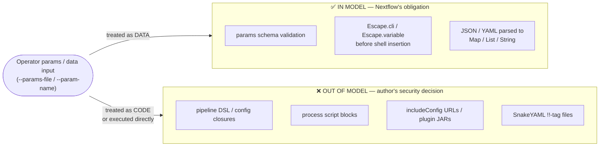
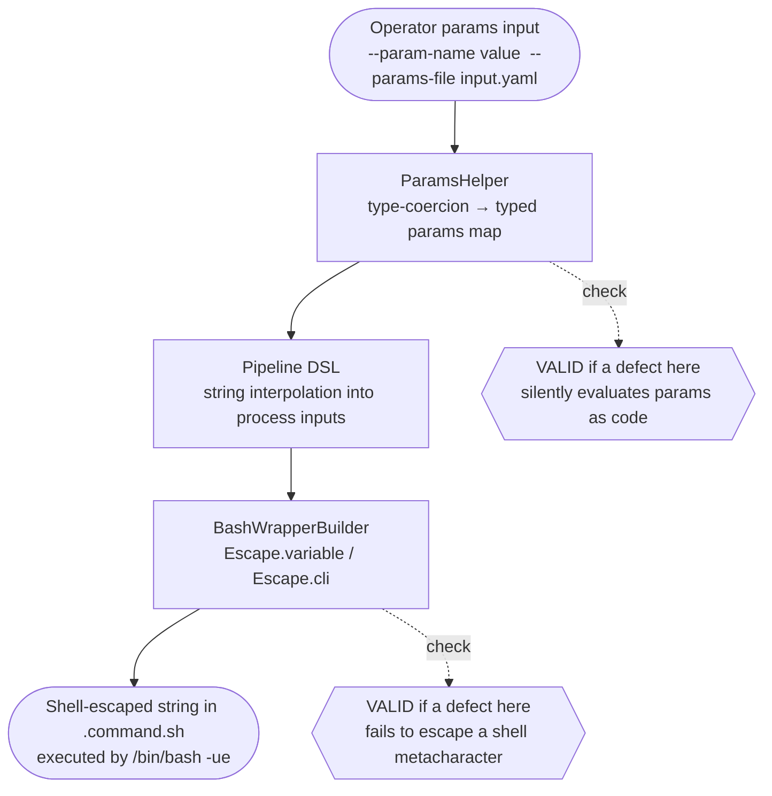

# Nextflow — Threat Model

**Applies to:** Nextflow 26.x (stable) and edge releases as covered by
[`SECURITY.md`](.github/SECURITY.md) (when present).

This document states what Nextflow treats as a security vulnerability and
what it does not. Its primary audience is twofold: maintainers triaging
reports, and **automated code-scanning tools (and the people reading their
output)**. Nextflow's nature as a workflow execution engine — built on top
of a Groovy DSL that compiles and runs user-authored pipelines — makes it
a magnet for pattern-based "findings" that are, by design, not
vulnerabilities; this document exists so those can be classified quickly
and consistently.

Each non-trivial claim carries a provenance tag:
*(documented)* — backed by shipped docs or source verified in this
repository; *(inferred)* — a reasoned position not yet formally confirmed
by the maintainers; *(maintainer)* — confirmed by the project's approval
of this document.

---

## 1. The one thing to understand first

**Nextflow is a scientific workflow orchestration engine. Compiling and
running the pipeline scripts and process blocks it is given is the entire
product — not a vulnerability.** *(maintainer)*

A Nextflow pipeline can open files on any mounted filesystem, spawn
arbitrary shell commands, read environment variables, make outbound
network requests, and call any Java or Groovy API. All of the following
are valid, working, *intended* Nextflow:

```groovy
// nextflow.config — evaluated as Groovy closures
process.beforeScript = 'source /etc/profile.d/modules.sh'

// main.nf — process block scripts are arbitrary shell
process ALIGN {
    script:
    """
    bwa mem ${params.genome} ${reads} > aligned.sam
    """
}

// main.nf — DSL closures have full Groovy / JVM access
Channel.fromPath(params.input_dir).map { f -> f.text }
```

One person's "dangerous capability" is every computational biologist's
reason for reaching for a workflow manager in the first place. The power
to orchestrate arbitrary shell commands and data transformations *on
demand* is the feature.

> The trust boundary is the **pipeline scripts, configuration files,
> process definitions, and plugin JARs that the operator chooses to
> run.** Everything on the pipeline's side of that boundary executes with
> the full authority of the host JVM and the OS user running Nextflow,
> by design.

Nextflow is **not a sandbox** and does not claim to be one. The project's
position is: **do not run pipelines you have not vetted.** Securing *which
pipelines you execute* is the operator's responsibility. *(documented)*

---

## 2. Scope and intended use

Nextflow is consumed as a **command-line orchestration engine** that
compiles a user-authored DSL into a dataflow graph and dispatches
compute tasks to one or more backends. The shapes that matter:

| Use shape | Description |
|-----------|-------------|
| **Local CLI** | An operator runs `nextflow run pipeline.nf` on their own machine, with HPC login node, or inside a container. The pipeline script is fully trusted. |
| **HPC / grid batch** | Nextflow submits task wrapper scripts to a scheduler (SLURM, LSF, PBS, SGE, …) on a shared filesystem. Tasks run as the same OS user. |
| **Cloud batch** | Tasks are dispatched to AWS Batch, Azure Batch, or Google Cloud Batch. Cloud credentials are operator-supplied. |
| **Kubernetes** | Tasks run as pods; Nextflow communicates with the Kubernetes API via `~/.kube/config`. |
| **Remote launch via Seqera Platform** | An operator triggers execution through the Seqera Platform API; Nextflow runs on a compute environment the operator provisioned. The `TOWER_ACCESS_TOKEN` authenticates the reporting channel back to the platform. |
| **AI agent processes (nf-agent)** | Pipeline processes may be declared as `agent` blocks that call an LLM API. Channel data is routed into prompts. |

### Caller roles

| Role | Trust level | What they control |
|------|-------------|-------------------|
| **Pipeline author** | **Fully trusted** | The `.nf` scripts, `nextflow.config`, included configs, DSL closures, process scripts, and declared plugins. Their code runs with full JVM authority — by design. |
| **Operator** | **Fully trusted** | What pipeline gets run, runtime parameters (`--params-*`, `--params-file`), environment variables, executor choice, and installed plugins. |
| **Plugin author** | **Trusted** (after publication via the official registry) | Provides JVM bytecode that runs inside the Nextflow process with the same authority as core code. |
| **End user of a platform built on Nextflow** | **Untrusted** | Supplies inputs to a workflow application. The pipeline author is responsible for not letting those inputs escape to untrusted execution. |

The security-relevant question is almost always: *did the pipeline author
route operator-supplied data to a shell command, a Groovy `eval`, or a
template engine — or only to a data structure?* The first is out of model
when the author chose it; the second is where Nextflow's obligations live.

---

## 3. Out of scope (explicit non-goals)

Findings whose mechanism is any of the following are, **by default, not
treated as vulnerabilities in Nextflow**, and their expected disposition
is out-of-model ([§13](#13-triage-dispositions)). "By default" is
deliberate: each report is still assessed before it is closed. We are
looking specifically for *surprising* behavior — a case where a
developer following Nextflow's documented practices would nonetheless be
caught out. That assessment can promote any item below to `VALID` (a
real bug), to `VALID-HARDENING`, or to `MODEL-GAP`.

- **Executing pipeline scripts, process blocks, and configuration
  closures.** Anything that relies on `nextflow run` compiling and
  running operator-supplied `.nf` scripts or `nextflow.config` files.
  The pipeline DSL is a Groovy superset; it is compiled by
  `GroovyClassLoader` and executed with full JVM authority. That is the
  product. *(documented)*

- **Process script blocks executing arbitrary shell.** A `script:`,
  `shell:`, or `exec:` block contains operator-authored shell commands.
  Nextflow writes these to `.command.sh` and executes them with
  `/bin/bash -ue`. Command injection inside a process block authored
  by the operator is not a Nextflow vulnerability — it is a consequence
  of the operator's own shell code.

- **Config DSL being evaluated as Groovy closures.** `nextflow.config`
  and any file reached via `includeConfig` are compiled and executed as
  Groovy. A `nextflow.config` that calls `"rm -rf /".execute()` does
  what it says. Remote `includeConfig` URLs fetch and execute remote
  Groovy with the operator's explicit permission. *(documented)*

- **`SnakeYAML` `new Yaml()` on operator-controlled files.** Several
  code paths use `new Yaml()` (without `SafeConstructor`) to parse
  files that are **operator-supplied and operator-trusted**: Kubernetes
  `~/.kube/config` (`ConfigDiscovery.groovy`), Spack environment
  files (`SpackCache.groovy`), module schema YAML
  (`ModuleSchemaValidator.groovy`, `ModuleSpecFactory.groovy`), skill
  definitions (`SkillResolver.groovy`), and params files supplied
  via `--params-file`. All of these are authored by the operator or by
  the trusted pipeline. Providing a YAML file containing `!!`-tag type
  constructors is equivalent to writing code in the config — out of
  model. *(inferred)*

- **Kryo deserialization from the local execution cache.** The
  `.nextflow/cache/<uuid>/` LevelDB store contains Kryo-serialised
  `TraceRecord` and `TaskContext` objects. This cache is written and
  read by the same operator on the same host. Crafting a malicious cache
  requires local write access — the attacker already has operator
  privileges. *(inferred)*

- **Plugin JARs running with JVM privileges.** Plugins are JVM bytecode
  installed under `~/.nextflow/plugins/`. They run inside the Nextflow
  process with full authority. This is the plugin model. A plugin that
  reads files or opens network connections is doing its job.

- **No new authority (equivalent-harm).** A finding that reaches an
  effect the actor could already reach by a legitimate, intended path
  grants no new authority and is out of model. If a pipeline author can
  already run arbitrary JVM code (by writing it in the pipeline DSL),
  a novel route to the same effect via plugin extension points or the
  Groovy MOP is not a privilege escalation.

- **Absence of a sandbox.** Nextflow provides no isolation of executed
  pipeline code from the JVM or host. Reports amounting to "a pipeline
  can touch the filesystem / network / processes" are out of model.

- **Vulnerabilities in dependencies or the JDK.** Report those upstream.
  A CVE in a dependency does not automatically mean Nextflow is affected;
  reachability must be demonstrated.

- **Prompt injection aimed at AI agents through pipeline output.** A
  process can emit text designed to be read as *instructions* by the
  `nf-agent` plugin (LangChain4j-backed). Nextflow routes channel data
  to LLM prompts faithfully ([§10](#10-downstream-responsibilities),
  item 9); sanitising it for a downstream LLM interpreter is the
  pipeline author's responsibility, exactly as sanitising output for a
  shell or SQL engine is.

- **Misuse by the pipeline author** — building shell commands by
  hand-concatenating params without using the standard binding mechanism,
  etc. Covered as *downstream responsibility* in
  [§10](#10-downstream-responsibilities).

---

## 4. Trust boundaries and data flow

The decisive boundary is **data vs. code**:



The highest-value review surface is therefore the **params-to-shell
pipeline**: the path from an operator-supplied parameter value, through the
Nextflow variable-expansion engine, into a bash process script. A defect
there (a param value escaping `Escape.variable` and being interpreted as
a shell command, or a YAML value causing type instantiation in a data
parser) crosses the boundary in a way the operator could not reasonably
anticipate, and *is* in model.

**What a real Nextflow-side injection bug looks like.** Nextflow is at
fault when a **Nextflow-shipped component itself routes operator-supplied
data into an evaluator the operator never asked to invoke** — for example,
if a GDK or DSL helper took a value passed purely as pipeline *data* and
silently compiled or evaluated it as a Groovy expression, or if
`Escape.variable` failed to escape a shell metacharacter in a task input.
That is the opposite of, and must not be conflated with, the pipeline
author *choosing* to call `"${params.cmd}".execute()` on operator input,
which is out of model.

---

## 5. Assumptions about the environment

- The JVM hosting Nextflow is itself trusted and adequately patched;
  Nextflow inherits the JDK's security posture. *(documented)*
- The operator's home directory (`~/.nextflow/`) is protected by
  OS-level file permissions (0600 for secrets, 0700 for the secrets
  directory). On a correctly configured host, other local users cannot
  read these files. *(documented — verified in `LocalSecretsProvider`)*
- The pipeline scripts and `nextflow.config` the operator runs reflect
  the operator's intent. If a pipeline was obtained from an untrusted
  source without vetting, that is an operator decision with consequences
  outside this model. *(inferred)*
- The plugin registry (`packages.seqera.io`) and the official Nextflow
  distribution are authentic. Official plugins ship with sha512 checksums
  verified at install time. Substituting a tampered plugin or Nextflow
  binary is a supply-chain compromise of the operator's environment —
  out of model here. *(documented)*
- On HPC clusters, the work directory resides on a shared filesystem.
  Other users on the cluster may be able to read the work directory
  unless the operator has applied restrictive umask or ACLs. This is an
  HPC environment baseline assumption, not a Nextflow assumption.
  *(inferred)*
- For cloud and Kubernetes deployments, IAM roles, service accounts,
  and network policies are the operator's responsibility and are outside
  Nextflow's scope. *(inferred)*

### 5a. Configuration knobs that affect this model

| Knob | Default | Security effect |
|------|---------|-----------------|
| `NXF_PLUGINS_REGISTRY_URL` | `packages.seqera.io` API | Redirects the plugin registry to an arbitrary URL. Only the official URL is supported; any other value triggers a warning. Plugins from an unofficial registry are not a supported configuration. |
| `NXF_SECRETS_FILE` | `~/.nextflow/secrets/store.json` | Relocates the secrets store. The file is always created 0600 regardless of location; a non-POSIX filesystem cannot enforce this. |
| `NXF_DEBUG` | `0` | Values `≥ 1` activate `bash -uex` tracing in task wrapper scripts, causing every command and its arguments to be printed to `.command.log`. Environment variables set via `withEnv {}` appear in the trace. Keep at `0` when tasks handle sensitive data. |
| `allowInsecure` (K8s `ClientConfig`) | `false` | When `true`, disables TLS hostname verification for the Kubernetes API server. Must not be enabled in production. |
| `tower.enabled` | `false` | When `true`, sends workflow metadata (including the resolved config, with secrets stripped) to Seqera Platform. |
| `fusion.enabled` | `false` | When `true`, mounts Fusion filesystem; requires a Seqera Platform license token exchanged at runtime. |

---

## 6. Assumptions about inputs

| Input | Trust | Notes |
|-------|-------|-------|
| Pipeline scripts (`.nf`) compiled and run by Nextflow | **Trusted by definition** | If they are not, the operator has already chosen to run untrusted code — out of model. |
| `nextflow.config` / `includeConfig` targets | **Trusted by definition** | Groovy DSL; remote includes are operator-chosen URLs. |
| Plugin JARs downloaded from the registry | **Trusted** (after sha512 verification) | sha512 authoritative value comes from the same HTTPS registry endpoint; independent code signing is not currently performed. |
| `--params-file` (YAML or JSON) | **Trusted (operator-controlled)** | The operator supplies and is responsible for this file. Parsed to `Map`/`List`/`String` values; values flow into typed params declarations and, via `Escape.variable`, into shell scripts. |
| `--param-name value` (CLI overrides) | **Trusted (operator-controlled)** | Same as above — operator-supplied at the command line. |
| SCM provider API responses (GitHub, GitLab, etc.) | **Partially trusted** | Authenticated over HTTPS; response content is treated as code (pipeline scripts) once fetched and committed to the local assets cache. |
| Cloud provider / Kubernetes API responses | **Trusted within the credential scope** | Operator-provisioned environment. |
| LLM provider API responses (nf-agent) | **May be untrusted** | Model outputs are tool-call arguments or final text; they may contain attacker-influenced content from training data or injected prompts. |

**Params-to-shell is the primary internal data path.** Operator-supplied
params are trusted, but their values are still DATA — not code. Nextflow's
obligation (P1) is to ensure those values never silently cross into code
evaluation. The path from params to shell execution is:



A defect in this chain — a type coercion that silently evaluates a param
as a Groovy expression, or a case `Escape.variable` does not handle — is
**`VALID`** because Nextflow itself crossed the data/code boundary without
the operator asking it to. The pipeline author's *deliberate* use of an
unescaped param (e.g. `script: "${params.cmd}"` without the `input:`
binding) is out of model — the author made that choice.

---

## 7. Adversary model

Because Nextflow is a CLI tool rather than a network service, there is
no single "remote attacker." The adversaries that matter:

**In scope**

- **A local user on a shared HPC filesystem.** Can read files in the
  work directory if the operator's umask allows it. Goal: access
  temporary secrets files, task scripts containing sensitive parameters,
  or output data. Cannot write to the operator's home directory.

- **A malicious LLM response injecting into nf-agent tool calls.** Can
  influence the LLM's output (e.g. via training data, retrieval
  augmentation, or a prior injection in the conversation history) to
  make the agent invoke unintended tools or emit unexpected outputs.
  Cannot directly modify pipeline scripts or environment variables.

**Capabilities the in-scope adversary has (closed list).** Reading files
on the shared work filesystem subject to OS permissions; influencing LLM
model outputs via training data or prompt history (nf-agent only). **A
finding that requires any capability not on this list is out of model**
([§11b](#11b-scanner-calibration-default-downgrade-rules)).

**Out of scope — explicitly, the adversary cannot be assumed to:**

- supply or modify pipeline scripts, `nextflow.config`, or plugin JARs
  (pipeline-author / operator privilege);
- alter environment variables, the `~/.nextflow/` directory, or the
  host OS (operator privilege or physical access);
- replace or tamper with the Nextflow binary or plugin JARs
  (supply-chain compromise of the host — see
  [§5](#5-assumptions-about-the-environment));
- attack the JVM/JDK or third-party dependencies rather than Nextflow
  itself.

---

## 8. Security properties the project provides

These are deliberately narrow guarantees for specific, verifiable
behaviors. Each has a CWE, an indicative severity if violated (a rough
band to help a scan prioritise, not a committed score), the condition
under which it holds, and what its violation would look like.

- **P1 — Shell-safe task input escaping.** Nextflow escapes process
  input values before embedding them in `.command.sh` bash scripts.
  Values interpolated via `Escape.variable` are double-quoted and
  have shell metacharacters escaped; values passed as CLI arguments
  use `Escape.cli` which applies single-quoting. *Condition:* the
  pipeline DSL uses the standard variable-binding mechanism (process
  `input:` declarations and their shell counterparts `$name`). A
  pipeline author who bypasses this by writing
  `script: "cmd ${params.x}"` directly is choosing their own escaping.
  *Violation:* a standard input-binding path allowing a param value to
  break out of its quoting context and execute as a shell command.
  CWE-78. *Indicative severity if violated: High.* *(documented —
  verified in `Escape.groovy`, `BashWrapperBuilder.groovy`)*

- **P2 — Secrets masked in logs and trace records.** Values whose config
  keys match `SecretHelper.SECRET_KEYS`
  (`~/AWS.+|.*TOKEN.*|.*PASSWORD.*|.*SECRET.*|.*accessKey.*|.*api_?key.*/`)
  are replaced with `[secret]` before being logged or included in trace
  files. Environment lines matching `SECRET_REGEX` are replaced with
  `NAME=[secure]` in the execution environment trace. *Condition:*
  secret keys follow one of the matched naming conventions; an
  unconventionally-named secret (e.g. `process.env.MY_CRED`) is not
  automatically masked. *Violation:* a value whose key matches
  `SECRET_KEYS` appearing in plaintext in a log file, trace record, or
  report HTML under a default configuration. CWE-312. *Indicative
  severity if violated: High.* *(documented — verified in
  `SecretHelper.groovy`, `TraceRecord.groovy`)*

- **P3 — Resolved config stripped of secrets before Tower transmission.**
  Before storing the resolved pipeline configuration in
  `session.resolvedConfig` (which is then sent to Seqera Platform as
  `workflow.configText`), the config parser is invoked with
  `setStripSecrets(true)`, replacing secret values with `[secret]`.
  *Condition:* `tower.enabled = true`; secrets named following the P2
  convention. *Violation:* a P2-convention secret value appearing
  verbatim in the `configText` payload sent to the Platform API.
  CWE-312. *Indicative severity if violated: High.* *(documented —
  verified in `ConfigCmdAdapter.groovy:641`,
  `TowerObserver.groovy:389`)*

- **P4 — Secrets store owner-only file permissions.** The secrets store
  (`~/.nextflow/secrets/store.json`) and the temporary task secrets file
  (`.nf-<hash>.secrets`) are created with POSIX permissions `rw-------`
  (0600) *before* any secret content is written, so there is no
  world-readable window. The parent directory is created `rwx------`
  (0700). *Condition:* a POSIX filesystem; non-POSIX filesystems (some
  NFS mounts, Windows CIFS shares) cannot enforce this. *Violation:* a
  default-configuration run creating either file with group- or
  world-readable permissions. CWE-732. *Indicative severity if violated:
  Medium (local).* *(documented — verified in
  `LocalSecretsProvider.groovy:175–185`)*

- **P5 — Plugin download integrity via sha512.** Plugin binaries
  downloaded from the registry are verified against a sha512 checksum
  before installation. A download whose checksum does not match is
  rejected. *Condition:* the official plugin registry is in use (not
  overridden by `NXF_PLUGINS_REGISTRY_URL`). *Violation:* a tampered
  plugin binary accepted and installed without checksum failure.
  CWE-494. *Indicative severity if violated: Critical.* *(documented —
  verified in `PluginUpdater.groovy`, `HttpPluginRepository.groovy`)*

- **P6 — SCM credentials obfuscated in debug logs.** Repository
  provider authentication credentials are never logged verbatim; only
  an obfuscated form (`user:***`) appears in debug output.
  *Condition:* logging at `DEBUG` level. *Violation:* a token or
  password appearing in plaintext in `.nextflow.log` at any log level.
  CWE-312. *Indicative severity if violated: Medium.* *(documented —
  verified in `RepositoryProvider.groovy:326`,
  `ProviderConfig.groovy:181`)*

A report demonstrating a *default-configuration* violation of P1–P6 is
a genuine vulnerability and should be reported privately per
[`SECURITY.md`](.github/SECURITY.md) ([§13: VALID](#13-triage-dispositions)).

---

## 9. Security properties the project does NOT provide

Nextflow does **not** claim, and you must not assume, any of the
following.

- **A sandbox / isolation of pipeline code.** Evaluated pipeline DSL
  and process scripts have full JVM and OS authority. There is no
  built-in mechanism that confines them.
- **Protection against malicious pipeline scripts.** Running a pipeline
  you did not author or vet is running arbitrary code on your
  infrastructure.
- **Encryption at rest for the secrets store.** `~/.nextflow/secrets/store.json`
  stores secret values as plaintext JSON. Permission-based protection
  (P4) is the only layer.
- **Independent code-signing for plugins.** Plugin integrity is verified
  by sha512 checksum whose authoritative value comes from the same
  HTTPS registry endpoint. A compromised registry can serve a malicious
  plugin with a matching checksum (P5 condition). Code signing with an
  independent signing key is not currently performed.
- **Authentication for pipeline execution.** Nextflow does not
  authenticate the operator; it inherits OS user privileges. Any user
  who can run `nextflow` on the host can execute pipelines with those
  credentials.
- **Sanitisation of pipeline outputs for downstream sinks.** Nextflow
  returns data faithfully to whatever consumes it (a shell, a report
  HTML, an LLM prompt). Encoding or filtering for a particular sink is
  the pipeline author's responsibility.
- **Rate limiting on pipeline execution or SCM fetches.** There is no
  per-operator or per-pipeline rate limit on task submission, SCM API
  calls, or plugin downloads. Exhaustion of external API quotas is the
  operator's concern.

---

## 10. Downstream responsibilities

If you author pipelines, operate Nextflow on behalf of others, or embed
Nextflow in a platform, **you** own these:

1. **Do not run pipelines you have not vetted.** A pipeline script is
   code. Pin to a specific revision (`-r <commit-sha>`), review the
   diff when upgrading, and treat `nextflow run user/repo` with the
   same care as `pip install user-package`.

2. **Use the standard `input:` / `$name` binding mechanism for process
   inputs.** It routes values through `Escape.variable` / `Escape.cli`
   (P1). A pipeline that builds a command by concatenating `params.x`
   directly into a GString without the binding mechanism bypasses
   escaping; Nextflow does not protect against that choice.

3. **Restrict the work directory on shared filesystems.** On an HPC
   cluster, set a restrictive umask (`umask 0077`) or use filesystem
   ACLs to prevent other cluster users from reading `.command.log`,
   `.command.env`, or intermediate output files that may contain
   sensitive data.

4. **Treat the secrets store as a convenience, not a vault.** The
   `~/.nextflow/secrets/` store is plaintext JSON protected only by
   POSIX permissions. For production workloads, use a proper secrets
   manager (cloud KMS, HashiCorp Vault) via a platform-level secrets
   provider plugin.

5. **Keep `NXF_DEBUG=0` when tasks handle sensitive data.** Debug
   tracing (`NXF_DEBUG ≥ 1`) adds `bash -uex` to task wrapper scripts,
   which prints all commands and their arguments — including interpolated
   environment variables — to `.command.log`.

6. **Validate param values at the sink when piping them to external
   systems.** Nextflow params are typed but not sanitized for SQL, HTTP,
   or filesystem injection beyond P1's shell escaping. Encode values
   appropriately for the target system (a database query, an API call,
   a file path) in the pipeline code that uses them.

7. **Pin plugin versions.** Use explicit `plugins { id 'nf-amazon@2.0.0' }`
   declarations rather than allowing automatic upgrades. Review changelogs
   when upgrading.

8. **Keep `allowInsecure = false` for Kubernetes.** Never enable this
   in a production cluster; the Kubernetes API server holds cluster-admin
   credentials.

9. **Validate / encode at your own boundaries** (output encoding,
   URL allow-lists, path canonicalization). Nextflow returns data
   faithfully; it does not sanitize it for your sink. This includes
   **AI agents** (`nf-agent`): faithfully-reproduced pipeline data can
   carry instructions aimed at an LLM that reads it (prompt injection).
   Treat all process output routed to an LLM prompt as data, never as
   instructions, and scope agent tool permissions to the minimum
   required.

10. **Stay on a supported version.** Check
    [`SECURITY.md`](.github/SECURITY.md) for the list.

---

## 11. Known misuse patterns

Common ways pipelines and integrations create vulnerabilities *with*
Nextflow (the vulnerability is in the pipeline or integration, not in
Nextflow itself):

- Embedding `params.x` directly in a process `script:` GString without
  relying on the typed `input:` / `$name` binding mechanism:
  ```groovy
  // UNSAFE — params.x is not escaped
  script: "samtools view -b ${params.extra_flags} input.bam"
  ```
- Calling `"${params.cmd}".execute()` or
  `['bash', '-c', params.cmd].execute()` in the pipeline DSL.
- Writing a `params-file` YAML whose values are paths that traverse
  outside the intended input directory; no path canonicalization is
  applied by the params engine.
- Enabling `NXF_DEBUG ≥ 1` in an environment where task `.command.log`
  files are readable by other users.
- Running `nextflow run user/repo` against an unpinned branch in a
  production environment; the branch can be updated to a malicious
  pipeline between runs.
- Overriding `NXF_PLUGINS_REGISTRY_URL` to an untrusted registry in
  CI.
- Relying on `SecretHelper` masking to protect an unconventionally-named
  credential (`MY_CRED`, `db_pass`); the pattern only matches the keys
  it was designed for.

### 11a. Known non-findings (recurring false positives)

A scanner sweeping Nextflow's source will flag the engine's own
machinery for running pipelines. These are **expected and not
vulnerabilities** unless a concrete, in-model data-boundary crossing
([§4](#4-trust-boundaries-and-data-flow)) is shown:

| Pattern in Nextflow's source | Disposition |
|------------------------------|-------------|
| `GroovyClassLoader` / `parseClass` / `ScriptRunner` compiling `.nf` files | The compiler doing its job — `KNOWN-NON-FINDING` |
| `ConfigParserV1` / `ConfigParserV2` evaluating `nextflow.config` as Groovy | Config DSL execution — `KNOWN-NON-FINDING` |
| `/bin/bash -ue` wrapping and executing process script blocks | Task execution — `KNOWN-NON-FINDING` |
| `Runtime.exec` / `ProcessBuilder` in executor / container builder code | Intended task / container launch — `OUT-OF-MODEL: downstream-responsibility` |
| `new Yaml()` (without `SafeConstructor`) parsing operator-controlled files (kubeconfig, spack env, params files authored by the operator) | Trusted-input surface — `OUT-OF-MODEL: trusted-input`; apply the data-boundary test: is this YAML path reachable from an *untrusted* source without operator consent? If so, surface as `MODEL-GAP`. |
| `KryoHelper.deserialize` reading from `.nextflow/cache/` | Operator-local trusted data — `OUT-OF-MODEL: trusted-input` |
| `PluginUpdater` downloading and loading JARs | Intended plugin installation, sha512 verified — `KNOWN-NON-FINDING` unless P5 is violated |
| `session.resolvedConfig` / `workflow.configText` sent to Tower | Secrets stripped via `setStripSecrets(true)` (P3) — `KNOWN-NON-FINDING` unless P3 or P2 is violated |
| `LocalSecretsProvider` writing secrets to a file | Secrets written 0600 before content (P4) — `KNOWN-NON-FINDING` unless P4 is violated |
| `RepositoryProvider` sending auth credentials in HTTP headers | Credentials obfuscated in logs (P6); HTTPS transport — `KNOWN-NON-FINDING` unless P6 is violated |
| `Escape.variable` / `Escape.cli` quoting task inputs | Shell-escaping mechanism (P1) — `KNOWN-NON-FINDING` unless P1 is violated |
| `includeConfig 'https://...'` fetching remote config | Operator explicitly chose to include this URL — `OUT-OF-MODEL: trusted-input` |
| `LangChainAgentRunner` routing channel data into LLM prompts | By design for nf-agent; prompt injection is downstream responsibility ([§10](#10-downstream-responsibilities)) — `OUT-OF-MODEL: downstream-responsibility` |

### 11b. Scanner calibration (default-downgrade rules)

A candidate finding is **downgraded to out-of-model by default** — surfaced
only if it *also* clears the bar in the right-hand column — when its
mechanism depends on any of the following:

| Downgrade by default when the finding depends on… | …unless it *also* shows |
|---------------------------------------------------|-------------------------|
| **Executing pipeline DSL, config closures, or process script blocks** ([§3](#3-out-of-scope-explicit-non-goals)) | a Nextflow component itself feeding untrusted *data* to an evaluator unrequested ([§4](#4-trust-boundaries-and-data-flow)) |
| **Operator-controlled files parsed with `new Yaml()`** (kubeconfig, spack env, params files, module schemas) | no escape hatch — all inputs to these paths are operator-controlled; always `OUT-OF-MODEL: trusted-input` |
| **Kryo deserialization from the local execution cache** | a path by which an actor can write to `.nextflow/cache/` without already having operator-level filesystem access |
| **Plugin JARs executing with JVM privileges** | P5 checksum bypass: a tampered binary accepted by the verifier |
| **equivalent-harm** — a new path to authority the actor already holds | the path crosses a trust boundary the actor did not already hold |
| **a PoC the model's adversary cannot stage** ([§7](#7-adversary-model)) | the capability is within the [§7](#7-adversary-model) closed list |

A finding that clears the right-hand bar is a real candidate; everything
else is closed with a one-line pointer to the cited section. **When a
finding is genuinely ambiguous, do not silently drop it — surface it as
`MODEL-GAP`** so a human decides.

---

## 12. Conditions that would change this model

- Nextflow shipping an officially-supported sandboxed execution mode for
  untrusted pipelines (would create new in-model properties and
  bypass-handling obligations).
- The `--params-file` / params DSL gaining code-evaluation semantics —
  e.g. a `!groovy` tag type in YAML being treated as an expression to
  evaluate (would create a data-to-code surface that *is* in model).
- Independent code-signing for plugin binaries being introduced (would
  make P5 stronger and make registry-level checksum spoofing
  insufficient to bypass it).
- A new Nextflow component accepting pipeline input or configuration
  **over a network socket** beyond the existing CLI (would introduce a
  network-reachable adversary the current model does not have).
- A change to P4 temp-file creation that allows a world-readable window
  during the secrets file write.

---

## 13. Triage dispositions

Every report should resolve to exactly one:

| Disposition | Meaning | Handling |
|-------------|---------|----------|
| **VALID** | Violates a provided property ([§8](#8-security-properties-the-project-provides)) in a default configuration | Private report per [`SECURITY.md`](.github/SECURITY.md); fix + advisory |
| **VALID-HARDENING** | By design and not a CVE, but we choose to improve secure-by-default behavior anyway | Handled in the open, normal priority; not embargoed |
| **OUT-OF-MODEL: executes-pipeline-code** | Relies on pipeline DSL, config closures, or process scripts doing what they say | Close citing [§3](#3-out-of-scope-explicit-non-goals) |
| **OUT-OF-MODEL: trusted-input** | Relies on attacker control of a file or value that the model treats as operator-controlled (pipeline script, kubeconfig, params from the operator) | Close citing [§3](#3-out-of-scope-explicit-non-goals)/[§6](#6-assumptions-about-inputs) |
| **OUT-OF-MODEL: downstream-responsibility** | Pipeline-authored shell/SQL/URL/path not validated at the sink (the pipeline author's responsibility, not Nextflow's) | Close citing [§10](#10-downstream-responsibilities) |
| **OUT-OF-MODEL: equivalent-harm** | A new path to an effect the actor could already reach legitimately ([§3](#3-out-of-scope-explicit-non-goals)) | Close citing [§3](#3-out-of-scope-explicit-non-goals) |
| **OUT-OF-MODEL: adversary-not-in-scope** | Requires a capability outside the [§7](#7-adversary-model) closed list (e.g. modifying pipeline source, replacing plugin JARs, supply-chain tampering) | Close citing [§7](#7-adversary-model) |
| **BY-DESIGN: property-disclaimed** | Targets a [§9](#9-security-properties-the-project-does-not-provide) non-property (e.g. "pipeline code can read files") | Close citing [§9](#9-security-properties-the-project-does-not-provide) |
| **KNOWN-NON-FINDING** | Matches [§11a](#11a-known-non-findings-recurring-false-positives) | Close citing the row |
| **MODEL-GAP** | A legitimate in-model scenario this document does not yet cover | Update this document, then re-triage |

**Batched scan reports.** An automated code scan typically arrives as a
single document bundling many candidate findings. Each candidate is
assigned exactly one disposition from the table above. Only `VALID` and
`VALID-HARDENING` items enter the coordinated flow in
[`SECURITY.md`](.github/SECURITY.md), and of those only `VALID` items
are embargo-sensitive; every other disposition is closed with a pointer
to its cited section. This lets a large scan be triaged as a table
without flooding the security process.

---

## Appendix A — back-map: existing documentation → threat-model section

| Existing source | Covers |
|-----------------|--------|
| `modules/nextflow/src/main/groovy/nextflow/util/SecretHelper.groovy` — `SECRET_KEYS` / `SECRET_REGEX` patterns | [§8 P2](#8-security-properties-the-project-provides) |
| `modules/nextflow/src/main/groovy/nextflow/secret/LocalSecretsProvider.groovy` — `createFile` with 0600 attribute | [§8 P4](#8-security-properties-the-project-provides) |
| `modules/nf-cli-v1/src/main/groovy/nextflow/config/ConfigCmdAdapter.groovy:641` — `setStripSecrets(true)` | [§8 P3](#8-security-properties-the-project-provides) |
| `modules/nextflow/src/main/groovy/nextflow/util/Escape.groovy` — `variable` / `cli` | [§8 P1](#8-security-properties-the-project-provides) |
| `modules/nf-commons/src/main/nextflow/plugin/PluginUpdater.groovy` / `HttpPluginRepository.groovy` — sha512 verification | [§8 P5](#8-security-properties-the-project-provides) |
| `modules/nextflow/src/main/groovy/nextflow/scm/RepositoryProvider.groovy:326` — `getAuthObfuscated` in debug log | [§8 P6](#8-security-properties-the-project-provides) |
| `.github/workflows/build.yml` — `permissions: contents: read`; fork PR secrets isolation | [§5](#5-assumptions-about-the-environment), [§11a](#11a-known-non-findings-recurring-false-positives) |
| `.github/workflows/claude.yml` — `author_association` guard; tool allowlist | [§7](#7-adversary-model), [§11a](#11a-known-non-findings-recurring-false-positives) |
| `plugins/nf-k8s/src/main/nextflow/k8s/client/K8sClient.groovy` — `allowInsecure` | [§5a](#5a-configuration-knobs-that-affect-this-model), [§9](#9-security-properties-the-project-does-not-provide) |
| `SECURITY_CONTEXT.md` (prior security architecture document) | full detail on entry/exit points, data flow, and findings; this document supersedes it for triage purposes |
